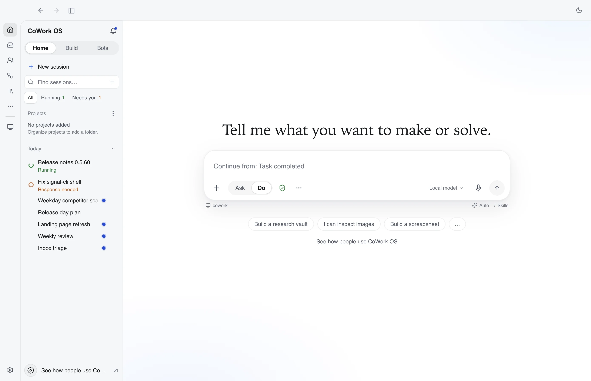

<p align="center">
  <picture>
    <source media="(prefers-color-scheme: dark)" srcset="screenshots/cowork-os-sl-dark-logo.png">
    <source media="(prefers-color-scheme: light)" srcset="screenshots/cowork-os-sl-color-logo.png">
    
  </picture>
</p>

<h3 align="center">The AI desktop where every action is visible and approvable before it runs.</h3>

<p align="center"><strong>Rent the model. Own everything else.</strong></p>

<p align="center">
  <a href="https://www.npmjs.com/package/cowork-os"></a>
  <a href="https://github.com/CoWork-OS/CoWork-OS/actions/workflows/ci.yml"></a>
  <a href="https://opensource.org/licenses/MIT"></a>
  <a href="https://github.com/CoWork-OS/CoWork-OS/discussions"></a>
  <a href="https://discord.gg/UjykKwjhRC"></a>
  <a href="https://github.com/CoWork-OS/CoWork-OS/issues?q=is%3Aissue+is%3Aopen+label%3A%22good+first+issue%22"></a>
</p>

<p align="center">
  <strong>English</strong> &middot; <a href="README.zh-CN.md">简体中文</a>
</p>

CoWork OS is a free, open-source desktop app for macOS and Windows that does real work for you: code, browser tasks, documents, inbox and automations. You watch each step as it happens. With the default **Ask for approval** access profile the agent works freely inside your workspace and stops to ask before anything that crosses it: sending, network access, credentials, exports, or files outside the workspace. Connect the model route you choose; your workspace, memory, skills and history stay on your machine. Model providers may charge for usage and receive the data needed for the tasks you run. [What you own](docs/what-you-own.md)

<p align="center">
  
</p>

| | |
| --- | --- |
| **Visible actions and approvals** | Every tool call shows in the task timeline. Access profiles (Ask for approval, Approve for me, Full access, Custom) decide what pauses for you, and hard limits hold even with approval. [Access profiles](docs/access-profiles.md) |
| **Everything Workbench** | Documents, spreadsheets, decks, web pages and PDFs open beside the agent, editable, with follow-up in place. [Everything Workbench](docs/everything-workbench.md) |
| **Inbox agent** | Local-first mail triage, evidence search, drafts and replies, with sending behind approval. [Inbox Agent](docs/inbox-agent.md) |
| **In-app browser** | A visible browser the agent drives while you watch, for research, forms and testing your own sites. [Browser Workbench](docs/browser-workbench.md) |
| **Bots and channels** | Reusable bots with their own memory and scheduled responsibilities, and a gateway that reaches you on Telegram, Slack, Discord, WhatsApp and more. [Bots](docs/bots-and-conversations.md) · [Channels](docs/channels.md) |
| **Memory you can read** | What CoWork knows lives as markdown in a local git folder you can edit, sync or delete. [Memory](docs/features.md#persistent-memory-system) |
| **Your choice of model** | ChatGPT sign-in, local Ollama, or API keys for Claude, OpenAI, Gemini, OpenRouter, Groq and more, switchable per conversation. [Models & Access](docs/providers.md) |

## Install

**macOS** (Apple Silicon, macOS 13 or later). No Gatekeeper dialog:

```bash
curl -fsSL https://coworkosapp.com/install.sh | bash
```

**Windows** (64-bit), in PowerShell. No SmartScreen prompt:

```powershell
irm https://coworkosapp.com/install.ps1 | iex
```

**Any platform with Node.js 24**, including Intel Macs. Installs the desktop app and the `cowork` CLI:

```bash
npm install -g cowork-os
```

Linux servers: use the [packaged headless server](docs/vps-linux.md). Re-run the same command to update.

<details>
<summary>Trouble installing? Use the DMG or EXE instead</summary>

Download the installer from [GitHub Releases](https://github.com/CoWork-OS/CoWork-OS/releases/latest). Releases are not notarized by Apple or code signed for Windows, so a browser download needs one extra step the first time:

- **macOS DMG:** drag CoWork OS into Applications and open it. When macOS says it was not opened, click **Done**, then go to **System Settings > Privacy & Security** and click **Open Anyway**. Step-by-step screenshots: [macOS Installation](docs/macos-installation.md).
- **Windows EXE:** when SmartScreen says **Windows protected your PC**, click **More info > Run anyway**. Checksums and antivirus notes: [Windows Installation](docs/windows-installation.md).
- **macOS 12 Monterey:** `0.5.51` is the last compatible release: `npm install -g cowork-os@0.5.51`.

</details>

## Getting started

1. **Open CoWork OS.** On macOS the first start may ask for the `cowork-os Safe Storage` keychain item; click **Always Allow**.
2. **Pick a model.** Sign in with ChatGPT, use a detected local Ollama model, or paste an API key. Free options are marked.
3. **Describe a task**, for example "make a spreadsheet of my last ten invoices from ~/Downloads", or pick one from the use-case gallery.
4. **Watch and approve.** The timeline shows each step. Work inside the workspace runs on its own; anything that sends, reaches the network, uses credentials or leaves the workspace waits for your answer.

From the terminal: `cowork` opens the terminal UI and `cowork run "who are you?"` runs a one-shot task against the same local profile. [Getting Started](docs/getting-started.md) · [CoWork CLI](docs/cli.md)

<!-- Migrating from Hermes or OpenClaw: section lands with the importer (docs/migrating-from-hermes.md). -->

## Documentation

| | |
| --- | --- |
| [Getting Started](docs/getting-started.md) | Install, first model, first task |
| [Feature Tour](docs/feature-tour.md) | Why CoWork OS, how a task runs, and the full feature inventory |
| [Features](docs/features.md) | Categorized feature reference |
| [Models & Access](docs/providers.md) | Provider routes, sign-ins, local models, fallbacks |
| [Access Profiles](docs/access-profiles.md) | Approvals, sandbox, network and filesystem policy |
| [Security Guide](docs/security-guide.md) | Threat model, guardrails, sandboxing, credential storage |
| [Self-Hosting](docs/self-hosting.md) | Linux server, Docker and remote access |
| [Development](docs/development.md) | Build from source and run the tests |
| [All docs](docs/) · [Changelog](CHANGELOG.md) · [Release Notes 0.5.60](docs/release-notes-0.5.60.md) | |

## Community

- **Chat:** [Discord](https://discord.gg/UjykKwjhRC): #help for questions, #show-and-tell for what you built, #contributors for working on CoWork OS
- **Questions and ideas:** [GitHub Discussions](https://github.com/CoWork-OS/CoWork-OS/discussions)
- **Bugs and requests:** [Issues](https://github.com/CoWork-OS/CoWork-OS/issues). We reply within a day.
- **Contribute:** start with a [good first issue](https://github.com/CoWork-OS/CoWork-OS/issues?q=is%3Aissue+is%3Aopen+label%3A%22good+first+issue%22) and read [CONTRIBUTING.md](CONTRIBUTING.md).
- **Security reports:** [SECURITY.md](SECURITY.md)

<!-- COWORK_PUBLIC_ADOPTION_STATS_START -->
### Adoption

| Signal | Current | All time |
|---|---:|---:|
| GitHub stars | 488 | n/a |
| GitHub forks | 86 | n/a |
| Installer/server downloads | 1,777 | 1,777 |
| Download delta | +15 | n/a |
| npm downloads | 243 (last week) | 9,583 |
| GitHub views, last 14-ish days | 899 total / 403 unique | n/a |
| GitHub clones, last 14-ish days | 16,134 total / 1,191 unique | n/a |

Generated 2026-10-17T07:44:52.096Z. These are public GitHub/npm adoption signals, not active-user or in-app telemetry numbers. All-time values are shown only where the source API provides lifetime coverage. [Full report](docs/public-adoption-stats.md).
<!-- COWORK_PUBLIC_ADOPTION_STATS_END -->

## License

MIT License. See [LICENSE](LICENSE).

---

<sub>"Cowork" is an Anthropic product name. CoWork OS is an independent open-source project and is not affiliated with, endorsed by, or sponsored by Anthropic. If requested by the rights holder, we will update naming/branding.</sub>
osai-verify: b359fb38a6b6ca5e28d0
