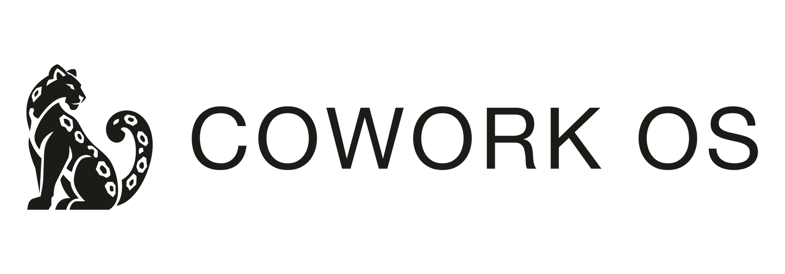
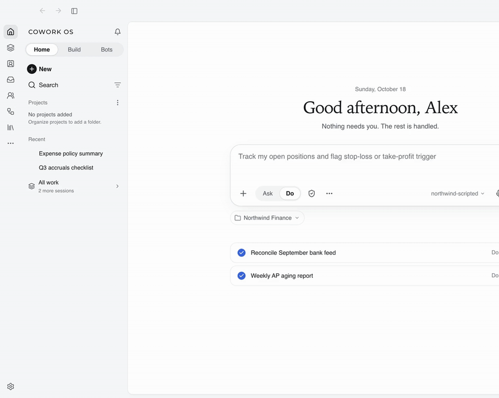
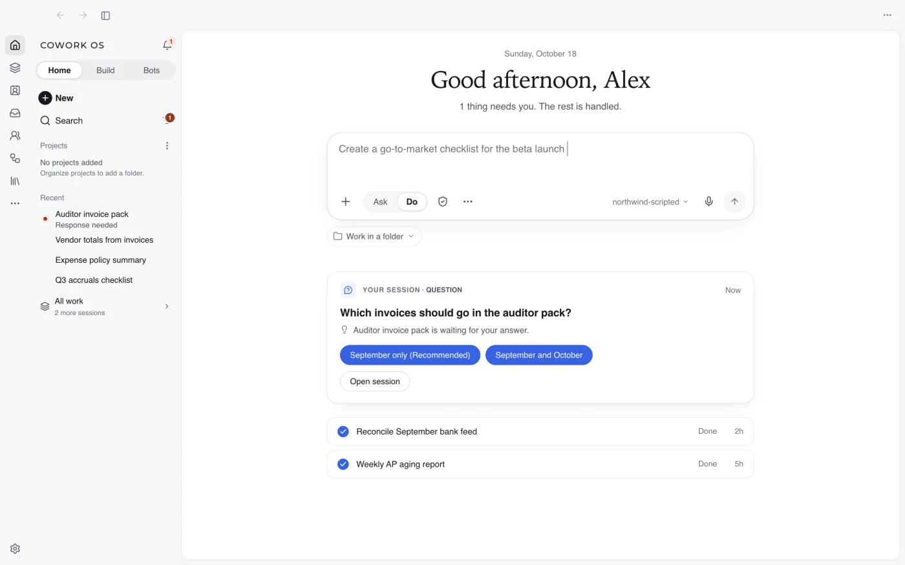
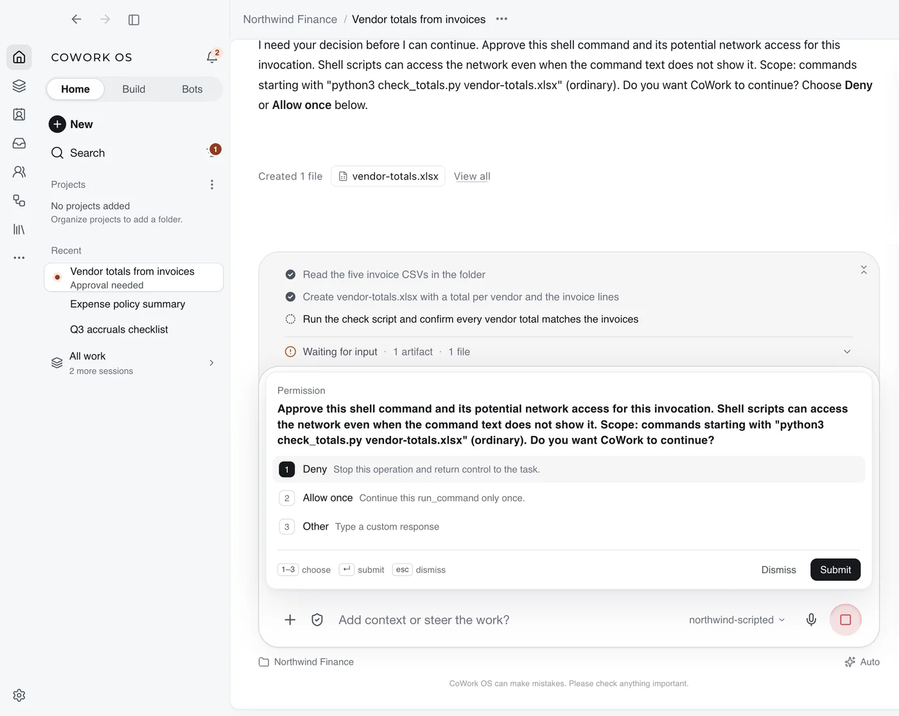
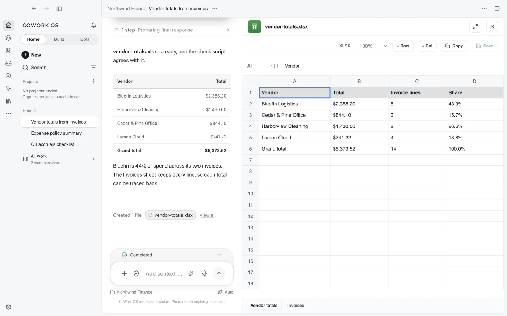

<p align="center">
  <picture>
    <source media="(prefers-color-scheme: dark)" srcset="screenshots/cowork-os-sl-dark-logo.png">
    <source media="(prefers-color-scheme: light)" srcset="screenshots/cowork-os-sl-color-logo.png">
    
  </picture>
</p>

<h3 align="center">每一步操作都看得见、执行前都由你批准的 AI 桌面应用。</h3>

<p align="center"><strong>模型可以租，其余都归你。</strong><br><sub>Rent the model. Own everything else.</sub></p>

<p align="center">
  <a href="https://www.npmjs.com/package/cowork-os"></a>
  <a href="https://github.com/CoWork-OS/CoWork-OS/actions/workflows/ci.yml"></a>
  <a href="https://opensource.org/licenses/MIT"></a>
  <a href="https://github.com/CoWork-OS/CoWork-OS/discussions"></a>
  <a href="https://discord.gg/UjykKwjhRC"></a>
</p>

<p align="center">
  <a href="README.md">English</a> &middot; <strong>简体中文</strong>
</p>

CoWork OS 是一款免费、开源的 macOS 和 Windows 桌面应用，帮你完成真正的工作：处理文件和文档、操作浏览器、整理邮件、运行定时任务。每一步都实时显示在任务时间线上。在默认的 **Ask for approval**（需要批准）访问配置下，智能体可以在你的工作区内自由工作，但凡是越出工作区的操作，比如发送消息、访问网络、使用凭据、导出数据或读写工作区以外的文件，都会先停下来等你确认。模型由你选择；你的工作区、记忆、技能和历史记录都保存在你自己的电脑上。模型服务商可能收取费用，并会收到你所运行任务需要的数据。[哪些东西归你](docs/what-you-own.md)

> 应用界面目前为英文。下文中的按钮和菜单名称保留英文原文，方便对照。

<p align="center">
  
</p>

<p align="center"><sub>MIT 协议 · 在你自己的电脑上运行 · 17,000+ 项自动化测试 · <a href="ZeroLeaks-Report-jn70f56art03m4rj7fp4b5k9p180aqfd.pdf">独立安全评估</a> · 欢迎贡献</sub></p>

## 你可以用它做什么

- **把一文件夹的文件变成成品。**“把这些发票整理成表格，按供应商汇总金额”——表格直接在对话旁打开，可以编辑，也可以原地让它继续修改。
- **处理收件箱，但主动权在你。**它会分拣、总结邮件并起草回复；在你批准之前，什么都不会发出去。
- **在你看得见的浏览器里做调研。**智能体在一个可见的窗口里浏览，你随时可以接管，最后交给你一份附带来源的报告。
- **让机器人按计划工作。**一个拥有自己记忆的机器人每天早上把摘要发到 Telegram、Slack 或 Discord，超出授权范围前会先问你。
- **写代码时每条命令都看得见。**真实的终端标签页、代码改动和测试结果都在时间线里，有风险的操作都需要你批准。
- **想全部留在本地也可以。**用 Ollama 或 LM Studio 在自己的电脑上运行模型，或者用 OpenRouter 登录，无需复制 API key 即可使用免费模型。

<table>
  <tr>
    <td width="33%"></td>
    <td width="33%"></td>
    <td width="33%"></td>
  </tr>
  <tr>
    <td align="center"><sub>Today：需要你的事，一件一张卡片</sub></td>
    <td align="center"><sub>每个有风险的步骤都等你回答</sub></td>
    <td align="center"><sub>结果直接在对话旁打开</sub></td>
  </tr>
</table>

| | |
| --- | --- |
| **每一步都看得见，有风险的由你批准** | 时间线实时显示每一次读取文件、运行命令和修改。访问配置（Ask for approval、Approve for me、Full access、Custom）决定哪些操作需要等你确认；硬性限制即使批准也不会放开。[访问配置](docs/access-profiles.md) |
| **拿到的是成品文件，而不只是回答** | 文档、表格、演示文稿、网页和 PDF 在智能体旁边打开，可以编辑，也可以直接要求修改，不必从头再来。[Everything Workbench](docs/everything-workbench.md) |
| **收件箱帮你起草，发送由你决定** | 本地优先的邮件分拣、跨邮件搜索和回复草稿；发送永远要等你确认。[Inbox Agent](docs/inbox-agent.md) |
| **一个你能看、能接管的浏览器** | 不会丢失页面的真实标签页、下载与历史记录；只有在你确认后，登录信息才会填入完全匹配的网站。[Browser Workbench](docs/browser-workbench.md) |
| **在你不在时也能干活的机器人** | 每个机器人有自己的记忆、模型和日程，可以通过 Telegram、Slack、Discord、WhatsApp 等渠道联系你。[Bots](docs/bots-and-conversations.md) · [Channels](docs/channels.md) |
| **能打开、能修改的记忆** | CoWork 记住的关于你的内容以 Markdown 文件保存在本地 git 文件夹里：可以查看、修改、同步或删除。[记忆](docs/features.md#persistent-memory-system) |
| **模型由你选，随时可以换** | OpenRouter 登录使用免费模型、ChatGPT 账号登录、本地 Ollama 或 LM Studio，或填入 Claude、OpenAI、Gemini、Groq 等的 API key，每个对话都可以切换。[模型与接入](docs/providers.md) |

## 为什么选择 CoWork OS？

| 如果你在用…… | 在这些情况下可以考虑 CoWork OS…… |
| --- | --- |
| 终端里的智能体（Hermes Agent、OpenClaw、Claude Code） | 想要同类智能体的桌面版：批准过程看得见，文件在对话旁打开，记忆可以直接阅读。CoWork 可以导入 Hermes 或 OpenClaw 的配置。 |
| 托管的桌面助手（ChatGPT、Claude Cowork） | 想要一个开源应用：模型自己选，能跑本地模型，工作区、记忆和历史都留在自己的电脑上。 |
| 写代码的智能体（Cursor、Codex） | 想在一个工作区里同时处理代码以及周边的一切：文档、邮件、浏览器、机器人和定时任务。 |

这些只是适用场景说明，不是排名；各产品的长处和每页的依据见 [Compare CoWork OS](docs/comparisons/index.md)（英文）。


## 安装

**macOS**（Apple 芯片，macOS 13 或更高版本），在终端中运行，不会弹出 Gatekeeper 拦截窗口：

```bash
curl -fsSL https://coworkosapp.com/install.sh | bash
```

**Windows**（64 位），在 PowerShell 中运行，不会出现 SmartScreen 提示：

```powershell
irm https://coworkosapp.com/install.ps1 | iex
```

**任何装有 Node.js 24 的系统**（包括 Intel Mac），同时安装桌面应用和 `cowork` 命令行工具：

```bash
npm install -g cowork-os
```

Linux 服务器请使用[打包好的无界面服务端](docs/vps-linux.md)。需要更新时，重新运行同一条命令即可。

> 如果访问 GitHub 较慢，npm 安装可以配合国内镜像使用，例如 `npm install -g cowork-os --registry=https://registry.npmmirror.com`。

<details>
<summary>安装遇到问题？改用 DMG 或 EXE 安装包</summary>

从 [GitHub Releases](https://github.com/CoWork-OS/CoWork-OS/releases/latest) 下载安装包。发布版本没有经过 Apple 公证，也没有 Windows 代码签名，所以通过浏览器下载后，第一次打开需要多一步：

- **macOS DMG：**把 CoWork OS 拖进“应用程序”并打开。系统提示无法打开时点 **完成**，然后进入 **系统设置 > 隐私与安全性**，点击 **仍要打开**。图文步骤见 [macOS 安装说明](docs/macos-installation.md)。
- **Windows EXE：**SmartScreen 提示“Windows 已保护你的电脑”时，点击 **更多信息 > 仍要运行**。校验和与杀毒软件误报说明见 [Windows 安装说明](docs/windows-installation.md)。
- **macOS 12 Monterey：**最后一个兼容版本是 `0.5.51`：`npm install -g cowork-os@0.5.51`。

</details>

## 快速上手

1. **打开 CoWork OS。**在 macOS 上首次启动时，系统可能会询问是否允许访问钥匙串项目 `cowork-os Safe Storage`，请点击 **始终允许**。
2. **选择模型。**选择 **Continue with OpenRouter**，无需复制 API key 即可使用免费模型（0.5.61 起）；也可以用 ChatGPT 账号登录、使用检测到的本地 Ollama 模型，或填入 API key。有免费额度的选项会被标出，模型随时可以切换。
3. **描述任务**，比如“把 ~/Downloads 里最近十张发票整理成一个表格”，也可以从用例库里选一个现成的任务。
4. **观察并批准。**时间线会显示每一步。工作区内的操作会自动进行；凡是发送、联网、使用凭据或离开工作区的操作，都会等你回答。

在终端中：`cowork` 打开终端界面，`cowork run "你是谁？"` 运行一次性任务，两者使用同一份本地配置。[入门指南](docs/getting-started.md) · [CoWork CLI](docs/cli.md)

## 从 Hermes 或 OpenClaw 迁移

可以把你的 Hermes Agent 或 OpenClaw 配置一起带过来（0.5.61 起）。CoWork 只读取 `~/.hermes` 或 `~/.openclaw`，不会修改它们，并会在写入任何内容之前先列出将要导入的项目：人设、记忆、你自己的技能、模型选择、聊天机器人及其白名单，以及定时任务。API key 和机器人令牌只有在你明确要求时才会导入，并保存在操作系统的加密存储中。

```bash
cowork import --from hermes --dry-run
cowork import --from hermes
```

OpenClaw 请使用 `--from openclaw`，也可以在应用的 **Settings > Import** 中操作；首次启动时如果发现上述文件夹，也会主动提示导入。你还可以继续使用现有的 Hermes，并通过 ACP 从 CoWork 把任务交给它。详见（英文）：[Migrating from Hermes](docs/migrating-from-hermes.md) · [Migrating from OpenClaw](docs/migrating-from-openclaw.md)

## 文档

以下文档目前为英文。

| | |
| --- | --- |
| [Getting Started](docs/getting-started.md) | 安装、第一个模型、第一个任务 |
| [Feature Tour](docs/feature-tour.md) | 为什么做 CoWork OS、任务如何运行、完整功能清单 |
| [Features](docs/features.md) | 按类别整理的功能参考 |
| [Models & Access](docs/providers.md) | 模型接入方式、账号登录、本地模型、备用链路 |
| [Access Profiles](docs/access-profiles.md) | 批准机制、沙箱、网络与文件系统策略 |
| [Security Guide](docs/security-guide.md) | 威胁模型、防护措施、沙箱、凭据存储 |
| [Self-Hosting](docs/self-hosting.md) | Linux 服务器、Docker 与远程访问 |
| [Development](docs/development.md) | 从源码构建并运行测试 |

## 社区

- **聊天：**[Discord](https://discord.gg/UjykKwjhRC)，中文交流请到 #中文 频道。
- **提问和想法：**[GitHub Discussions](https://github.com/CoWork-OS/CoWork-OS/discussions)，中文提问也欢迎。
- **Bug 与需求：**[Issues](https://github.com/CoWork-OS/CoWork-OS/issues)，我们会在一天内回复。
- **参与贡献：**从 [good first issue](https://github.com/CoWork-OS/CoWork-OS/issues?q=is%3Aissue+is%3Aopen+label%3A%22good+first+issue%22) 开始，并阅读 [CONTRIBUTING.md](CONTRIBUTING.md)。改进中文文档和翻译同样是很有价值的贡献。
- **安全问题：**[SECURITY.md](SECURITY.md)

## 许可证

MIT 许可证，见 [LICENSE](LICENSE)。

---

<sub>“Cowork” 是 Anthropic 的产品名称。CoWork OS 是独立的开源项目，与 Anthropic 没有关联，也未获得其认可或赞助。如权利人提出要求，我们将调整名称和品牌。</sub>
