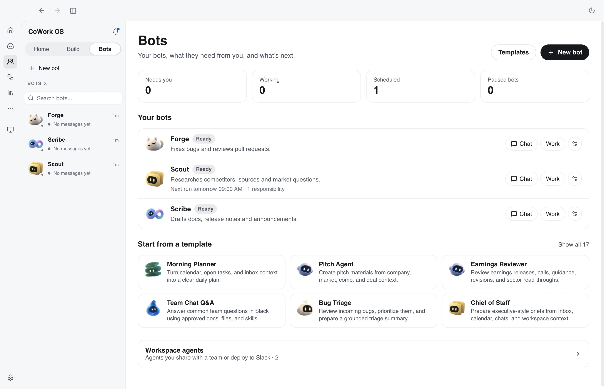

# Managed Agents

Managed Agents adds a first-class, GUI-first managed resource model to CoWork without replacing the existing task runtime or the new terminal entrypoint. It is one of the core reasons CoWork OS is positioned as a personal AI super app and everything app: users can create reusable agents, spawn work from templates or prompts, inspect configuration, run tests, and monitor execution from visual surfaces, while `cowork` remains available for terminal-native task starts.

V1 introduces three control-plane resources:

- `ManagedAgent`: reusable, versioned execution definition
- `ManagedEnvironment`: reusable local execution template
- `ManagedSession`: durable run resource that owns lifecycle, event history, and resume semantics

The implementation is local-first and additive. Managed resources are exposed through the control plane and the **Workspace agents** section of the Bots page (formerly Agents Hub), while existing `Task`, `AgentTeamRun`, `task_events`, and `session_runtime_v2` remain the execution primitives underneath.

<p align="center">
  
  <br><em>The Bots page is the main surface for bots, templates, and workspace agents (managed agents).</em>
</p>

## Why This Exists

CoWork already had the low-level pieces for durable execution, team runs, worktree isolation, MCP integration, and resumable task runtime state. Managed Agents packages those pieces into reusable definitions and a stable run identity so GUI and backend surfaces can reason about durable agent runs directly instead of reconstructing them from ad hoc task metadata.

The product goal is that a user can manage many agents visually: create or generate agents, inspect tools and skills, launch tests, spawn starter prompts, watch child tasks, review approvals, and hand work into Mission Control without switching to a CLI workflow.

The model is:

- define reusable behavior in `ManagedAgent`
- define reusable local policy in `ManagedEnvironment`
- execute and observe durable runs through `ManagedSession`

## V1 Scope

Managed Agents V1 is intentionally narrow:

- local execution only through `ManagedEnvironment.kind = "cowork_local"`
- renderer support through **Workspace agents** on the Bots page for creation, inspection, governance, and manual runs
- existing task APIs remain supported
- Mission Control and task surfaces observe the backing task or team run created by each managed session
- no private agent-detail chat surface; every runnable action is processed as a normal main-window task

This means Managed Agents is an additive product surface on top of the existing task runtime. **Workspace agents** configures reusable agents, but the main task window remains the only place where agent work, questions, responses, approvals, and outputs are shown.

## Control-Plane Surface

Managed Agents is available through the existing dot-style control-plane namespace.

Agent methods:

- `managedAgent.list`
- `managedAgent.get`
- `managedAgent.create`
- `managedAgent.update`
- `managedAgent.archive`
- `managedAgent.version.list`
- `managedAgent.version.get`

Environment methods:

- `managedEnvironment.list`
- `managedEnvironment.get`
- `managedEnvironment.create`
- `managedEnvironment.update`
- `managedEnvironment.archive`

Session methods:

- `managedSession.list`
- `managedSession.get`
- `managedSession.create`
- `managedSession.cancel`
- `managedSession.resume`
- `managedSession.sendEvent`
- `managedSession.events.list`
- `managedSession.exportHandoff`
- `managedSession.importHandoff`

Managed-session broadcasts:

- `managedSession.created`
- `managedSession.updated`
- `managedSession.event`
- `managedSession.completed`
- `managedSession.failed`

## Runtime Mapping

Managed Agents is not a second executor. It maps onto the existing runtime:

- `ManagedAgentVersion` becomes the source of truth for model, prompt, execution mode, and runtime defaults
- `ManagedEnvironment` becomes the source of truth for workspace binding, access profile, tool
  policy, MCP scope, and execution affordances. `config.accessProfileId` is the canonical way to
  choose command, filesystem, network, sandbox, and approval behavior for managed sessions.
- `ManagedSession` creates exactly one backing `Task`
- team-mode `ManagedSession` also creates a backing `AgentTeamRun`
- `task_events` and daemon notifications are mirrored into `managed_session_events`
- `session_runtime_v2` remains task-scoped runtime state owned by `SessionRuntime`
- Workspace agents manual actions create `runtime` managed sessions and then open the backing task in the main task view

The important contract is that `ManagedSession` is the API-facing durable run, while `Task` remains the execution worker.

## Workspace Agents Concept

Managed agents are configured in the **Workspace agents** section of the Bots page (select **Bots** on the left icon rail, then expand **Workspace agents**). This surface was called Agents Hub before 0.5.60.

It owns:

- agent discovery across managed agents, templates, scheduled agents, and migrated personas
- natural-language agent creation through the builder
- template-backed drafts, required connectors, selected skills, runtime tools, memory, files, schedule, channels, approvals, sharing, and deployment posture
- managed-agent inspection, publish/suspend controls, Slack/channel status, runtime tool catalog, audit hints, and current instructions

The selected-agent detail screen is intentionally single-pane. It is not a chat room and it does not have a bottom ask box. Clicking a managed agent shows its configuration and action buttons in the main detail page.

The supported action model is:

- **Test this agent** creates a managed session with `surface: "runtime"` and opens the session's backing task in the main task window
- **Preview** follows the same runtime task path
- starter prompt cards follow the same runtime task path
- **Edit agent** opens the agent draft/editor surface to change its configuration
- any follow-up questions, approvals, responses, files, and final outputs belong to the opened task, not to the agent detail screen

This keeps all agent execution observable through the same task timeline, right-panel artifacts, approvals, notifications, and completion behavior as ordinary user-created tasks.

## Relation To Dreaming

Managed Agents do not own memory curation policy.

Managed sessions can produce task transcripts, task results, and memory observations like ordinary tasks. Dreaming may later read recent task conversations in its daily pass over the memory folder, and edits that touch your own notes wait for review like any other dream change.

That keeps Managed Agents focused on reusable execution identity while Memory, Heartbeat, Reflection, Dreaming, and Suggestions remain the core Workflow Intelligence runtime. See [Dreaming](dreaming.md).

## Managed Turn Budgets

Managed Agents keep explicit turn caps because managed runs are often unattended or intentionally bounded.

- `ManagedAgentVersion.runtimeDefaults.maxTurns` is passed through as an explicit cap on the backing task when configured
- if a managed agent does not set `runtimeDefaults.maxTurns`, the backing task inherits the same default-unbounded main-task behavior as ordinary interactive sessions
- this differs from older strategy behavior: the runtime no longer invents a low implicit window such as `30` turns just because the task routed as `advice` or `planning`

In practice:

- use `runtimeDefaults.maxTurns` when you want a managed session to stop after a defined number of turns
- leave it unset when you want the run to rely on lifetime caps, emergency fuses, and the normal recovery/safety model instead

## Security And Policy Boundaries

Managed Agents follows the same security posture as the rest of CoWork, with a few managed-specific rules:

- renderer-facing managed environment reads redact `credentialRefs` and `managedAccountRefs`
- managed session events are sanitized before persistence and sanitized again on read
- MCP allowlists fail closed if the referenced server or its cached tool metadata is unavailable
- managed account refs are validated server-side at environment creation/update time
- the effective access profile is resolved and enforced on the target environment before the
  backing task starts; a missing or invalid named profile produces a read-only unavailable-profile
  state instead of widening access
- child work spawned by a managed session cannot select a profile broader than the managed
  session's profile
- legacy tasks, runs, and team APIs are unchanged for non-managed flows

These rules keep the managed control-plane surface suitable for UI/backend consumption without exposing sensitive linkage or silently broadening tool access.

## Durable Session Handoffs

A handoff package carries an in-progress session to a new managed session, on the same
installation or another one. It is an open, versioned JSON format that you own. It does not
carry cookies, live processes or granted approvals, and it leaves out values and files that look
like credentials (see the limits below).

### What the package contains

Export writes `<workspace>/.cowork/handoffs/<package-id>/`:

```text
manifest.json          kind "cowork.session-handoff", schemaVersion 1
artifacts/<path>       copies of the files the session wrote, checked by sha256
.gitignore             "*", so the package is not committed by accident
```

| Part                   | What survives                                                                                      |
| ---------------------- | -------------------------------------------------------------------------------------------------- |
| Goal and requirements  | The objective and each requirement with its status (pending, satisfied, failed, waived)            |
| Decisions              | Active decisions, constraints and unverified assumptions, plus reversed (superseded) decisions     |
| Pending waits          | Approvals and input the session was still waiting for, as reasons only                             |
| Evidence               | Claims, sources, capture time, freshness window and status                                        |
| Files                  | The latest committed revision per path, copied only if its bytes still match the session record   |
| Completed side effects | Keys of tool calls the session already completed                                                   |
| Transcript             | Up to 200 recent messages and tool-call names, each at most 2,000 characters                       |
| Checkpoint             | The latest transcript checkpoint summary, at most 8,000 characters                                |

Redaction and limits:

- Strings go through the WorkSession redaction rules and the memory secret scanner (API keys,
  tokens, JWTs, private-key blocks, URL credentials, `password=`-style assignments). Ledger
  entries marked `secret_redacted` and sensitive transcript items are dropped. Pattern-based
  redaction can miss an unusual secret format, so review a package before you share it.
- Files named like credentials (`.env*`, `*.pem`, `*.key`, `id_rsa*`, `.npmrc`, `credentials*`
  and similar) and text files in which the scanner finds a secret are listed but not copied.
- Size limits: 8 MB manifest, 16 MB per file, 64 MB of files per package.
- `checksum` is the sha256 of the canonical JSON of all other fields. It detects a damaged or
  carelessly edited package. It does not prove who exported the package: anyone who edits it can
  recompute it. Treat a package from someone else like any other file you received.

### Export

- Mission Control: open a task and choose **Export handoff**.
- CLI: `cowork handoff export <managedSessionId>` or `cowork handoff export --task <taskId>`,
  optionally `--out <dir inside the workspace>`.
- Control Plane: `managedSession.exportHandoff` with `{ sessionId }` or `{ taskId }`, optionally
  `targetDir` (admin scope).

A file that changed after the session recorded it is listed with `copied: false` and a warning.
Files outside the workspace, symlinked paths and unsafe names are skipped.

### Import and resume

Copy the package folder into the target workspace's `.cowork/handoffs/`, then:

- CLI: `cowork handoff import <package dir> --environment <environmentId>`. Add `--dry-run` to
  see what would be restored without writing anything, and `--agent <agentId>` when the source
  agent does not exist on this installation.
- Control Plane: `managedSession.importHandoff` with
  `{ manifestPath, environmentId, agentId?, dryRun? }`.

Import:

1. reads the manifest only from `.cowork/handoffs/<package>/` in the target environment's
   workspace, through a descriptor that refuses symlinks, validates the schema and checksum, and
   checks the agent before anything is written;
2. refuses a package whose files add up to more than 64 MB;
3. restores each copied file after checking its size and sha256. It never creates hidden files
   or folders (`.cowork`, `.git`, `.github`, `.vscode`, `.husky`, `.env` and the like), files under
   `node_modules`, or agent instruction files (`AGENTS.md` and similar),
   because later tasks would load them as instructions or code; those stay readable inside the
   package folder. A mismatching or symlinked copy is skipped, and an existing different file is
   kept, never overwritten;
4. creates a new managed session whose first message carries the package summary inside a
   `BEGIN HANDOFF PACKAGE <nonce> … END HANDOFF PACKAGE <nonce>` block. The nonce is random per
   import, every value from the package is flattened to a single line, claims are labelled
   unverified, and the message is capped at 8,000 characters;
5. seeds the new session's contract with the decisions and constraints (reversals included) and
   earlier requirements, each marked "(imported, unverified)", and the restored files as artifact
   revisions;
6. turns each pending approval or input into a new pending wait on the new session. Nothing the
   earlier session asked for is granted; the new session asks again, and the carried-over wait is
   closed when the new task finishes;
7. records lineage: `resumedFromSessionId` when the source session exists in the same workspace
   on this installation, and a `handoff.imported` session event with the package id, source
   session ids and `originVerified: false`.

Normal access profiles, approvals, connector policy and provider settings apply to the resumed run.

Implementation: `src/electron/managed/session-handoff.ts` (manifest build, checksum, import
message, path and restore rules), `src/electron/managed/session-handoff-io.ts` (containment,
copies, restore) and `ManagedSessionService.exportHandoff` / `importHandoff`. Tests:
`src/electron/managed/__tests__/ManagedSessionService.handoff.test.ts`,
`src/electron/managed/__tests__/session-handoff.test.ts` and the `handoff` replay fixture in
`src/electron/sessions/WorkSessionReplayEvaluationService.ts`.

## Current UI State

Managed Agents has a dedicated renderer surface: **Workspace agents** on the Bots page.

Today’s product workflow is:

1. select **Bots** on the left icon rail and expand **Workspace agents**
2. create an agent from a prompt, a template, or an existing role/profile conversion
3. review and adjust tools, skills, files, memory, approvals, schedule, channels, and instructions
4. save or publish the agent
5. click **Test this agent**, **Preview**, or a starter prompt
6. observe the resulting backing task in the normal main task UI and Mission Control

The Control Plane remains available for API-level creation and smoke testing, but it is no longer the only practical test path from the desktop app.

## Manual App Test Flow

Use a solo session first:

```js
const workspaces = await request("workspace.list", {});
const workspaceId = workspaces.workspaces[0]?.id;

const environment = await request("managedEnvironment.create", {
  name: "Local Test Env",
  config: {
    workspaceId,
    accessProfileId: "ask_for_approval",
    enableBrowser: true,
  },
});

const agent = await request("managedAgent.create", {
  name: "Managed Test Agent",
  systemPrompt: "You are a precise coding assistant.",
  executionMode: "solo",
  runtimeDefaults: {
    autonomousMode: true,
    allowUserInput: true,
  },
});

const session = await request("managedSession.create", {
  agentId: agent.agent.id,
  environmentId: environment.environment.id,
  title: "Managed Session Smoke Test",
  initialEvent: {
    type: "user.message",
    content: [{ type: "text", text: "Inspect the repo and summarize it." }],
  },
});
```

Then verify:

- a normal task appears in the desktop UI
- the task starts through the normal daemon lifecycle
- `managedSession.get` shows the backing task link and current status
- `managedSession.events.list` returns sanitized event payloads
- Manual runs started from Workspace agents open the backing task in the main window rather than rendering a separate agent-panel transcript

For team mode:

- create a `ManagedAgent` with `executionMode: "team"`
- create a managed session
- observe the backing team run from Mission Control and task surfaces
- send `managedSession.sendEvent` with `user.message` to route new guidance to the team root
- observe the guidance in the root task timeline and in future pending/synthesis team prompts
- fork a terminal team session when the user needs a new independent continuation

## Compatibility Contract

Managed Agents must not break existing flows.

The additive contract is:

- legacy `task.*` methods still create and run ordinary tasks
- legacy task timelines and approvals still work
- Agent Teams still work outside managed sessions
- managed sessions reuse the daemon and runtime instead of bypassing them
- managed resources add a new control-plane namespace; they do not replace existing APIs
- `enableShell` may still be present in older persisted environment configurations, but it is a
  compatibility field only. New and edited environments should set `config.accessProfileId`; the
  Workspace agents does not expose a separate shell toggle.

See [Access Profiles](access-profiles.md#surfaces-and-inheritance) for the cross-surface contract.

When changing this system, preserve that boundary and update the tests that prove it.
