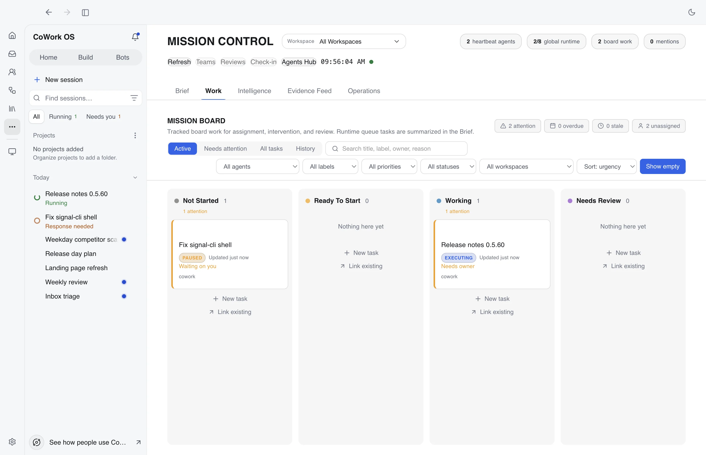

# Mission Control

Mission Control is a centralized, GUI-first agent orchestration and monitoring dashboard. It provides the main cockpit for managing many agents, tracking board work, monitoring the global runtime queue, reviewing approvals, and overseeing team-based collaboration without reducing agent operations to terminal output.

Heartbeat v3 is the default background automation model exposed here. Mission Control should be read as pulse/defer/dispatch truth, not as a wake-queue monitor. Mission Control also surfaces the `Core Harness` and should eventually surface Dreaming runs/candidates as the reviewable memory-curation lane. See [Heartbeat v3](heartbeat-v3.md), [Dreaming](dreaming.md), and [Core Automation](core-automation.md) for the runtime model.

Open **Mission Control** from **More** on the left icon rail (in both the standard and Calm interfaces; pin it to keep it on the rail). The exact path depends on the app release; see the [release surface reference](release-surface-reference.md) before following a version-specific navigation path.

Mission Control observes and configures tasks; it is not a second permission
plane. When creating or editing an agent or automation, review the attached
[access profile](access-profiles.md) alongside its autonomy, tool, connector,
and workspace settings. Planner, Heartbeat, and dispatch policies can narrow
or defer work, but they cannot widen the profile or revive an unavailable one.

  
   <em>Mission Control brings global runtime queue state, assigned board work, live feed, and review state into one operations view.</em>

Mission Control now sits alongside the other operational entry points:

- **Devices** (in **Team** in the Calm theme) for machine-level task routing and remote execution
- main-sidebar **Automations** for structured flow authoring, activation, approvals, and step-level Activity
- **Settings > Automations** for prompt-based routines, core automation, queueing, scheduling, triggers, briefing, and Workflow Intelligence policies
- **Settings > Memory** for the memory folder, structured observations, and dream changes waiting in **Review**

## Layout

Mission Control has two main areas:

| Panel                      | Purpose                                                                                                                                    |
| -------------------------- | ------------------------------------------------------------------------------------------------------------------------------------------ |
| **Center — Mission Board** | The **Work** tab: a 5-column Kanban board of the workspace's tasks                                                                         |
| **Right — Feed & Details** | Live activity feed and selected task details with comments/mentions                                                                        |

The header bar shows workspace selector, current time, and operational counters grouped by source:

- **Heartbeat agents**: enabled background roles that may be monitoring or idle.
- **Global runtime queue**: tasks currently running or waiting for an execution slot. This matches the chat/right-panel queue and can include work from another workspace.
- **Board work**: open work items tracked on the Mission Control board.
- **Mentions**: pending human or agent mentions.

On **Brief**, **need you** counts the approvals, questions and paused sessions waiting on you in the selected workspace (and agent, when one is selected). The **Needs You** section lists them, and each opens where it is decided. Today, Bots and the bell count the same decisions; Mission Control's own flags are listed under **Flagged**.

The header's **Bots** button opens the Bots page, where agents are created and configured. In the Calm theme it reads **Team** and opens Team, which shows each agent with what it is doing, what it waits on you for and where it runs.

These numbers can differ. For example, two Heartbeat agents can be enabled while zero board items are open in the selected workspace and four global runtime tasks are waiting in chat. If the queue service is still loading or unavailable, Mission Control shows that state explicitly instead of reporting `0` or `All clear`.

---

## Agents

Mission Control doesn't keep its own agent list. Agents are created and configured on the Bots page: the header's **Bots** button, or **Team** in the Calm theme, which also shows what each agent is doing, what it is waiting on you for, its seniority (lead, specialist or intern, which only paces its heartbeat) and **May do alone**, its [access limit](access-profiles.md#agent-access-limits). On the board, **Wake owner** on a card runs the assigned agent's heartbeat review now.

---

## Mission Board — Work Tab (Center)

The **Work** tab is a 5-column Kanban board of the recent tasks in the selected workspace (every workspace when **All workspaces** is selected). Nothing is added to it by hand: a task started from the composer, by an agent's heartbeat, a team or the planner shows up on its own, in the column that matches its state. So the board has no **New task** or **Link existing** buttons; start work from the composer and it appears here. This board is separate from the live global runtime queue: runtime tasks can be running or waiting even when the board has no open work in the current view.

| Column             | What lands here                                                          |
| ------------------ | ------------------------------------------------------------------------ |
| **Not started**    | Open tasks with no owner that aren't running                             |
| **Ready to start** | Open tasks with an assigned agent that aren't running, or moved here     |
| **Working**        | Tasks being planned or executed, and tasks moved here                    |
| **Needs review**   | Tasks moved here for approval or human review                            |
| **Done**           | Completed, failed, cancelled and interrupted tasks, and tasks moved here |

A finished task always sits in **Done**, and a running one in **Working** unless it was moved to **Needs review** or **Done**.

### Views and Filters

- **Active** shows open tasks, **Needs attention** shows failed, interrupted and flagged ones, and **All tasks** shows everything. **Done** stays hidden until **History** is on or **All tasks** is picked.
- Search matches title, brief, label, owner, flag reason and workspace. Filter by agent, label, priority, status and (with **All workspaces**) workspace, and sort by urgency, last update, due date or priority.
- **Show empty** keeps empty columns visible; turn it off to hide them.
- The header counts what needs attention, is overdue, is stale or has no owner. A column's count turns red past its limit (8 in **Ready to start**, 5 in **Working**, 4 in **Needs review**).

### Task Cards

Each card shows:

- Task title, status pill and time since the last update
- Priority and up to two labels
- Why it needs attention, when it does (for example _Waiting on you_, _Needs owner_, _Overdue_, _Stale_)
- The assigned agent's character, name and status
- Due date, estimate and a stale chip, when set
- The workspace, when **All workspaces** is selected

### Interactions

- **Drag and drop** a card between columns to move it
- **Click** a card to open its details in the right panel, where you can change its owner, stage, priority, estimate, due date and labels
- Card buttons: **Open details**, **Cycle priority**, **Wake owner** (runs the owner's heartbeat review now) and **Move to next stage**

---

## Global Runtime Queue

The Brief tab includes a **Global Runtime Queue** card. It is sourced from the same task executor queue used by chat and the right-panel lineup:

- **Running** tasks are currently occupying execution slots.
- **Waiting** tasks are queued for the next available execution slot.
- **Unavailable** means the queue service could not be read, so Mission Control cannot truthfully claim the queue is empty.

This queue is global to the local CoWork runtime. It can include tasks from workspaces outside the current Mission Control workspace selector. When a queued task belongs outside the visible workspace scope, Mission Control still includes it in the global queue count and marks the row as outside scope instead of hiding the discrepancy.

The **Mission Board** remains workspace-scoped tracked work. A workspace can have no open board work while the global runtime queue still has running or waiting tasks.

---

## Feed & Task Details (Right)

Tabbed panel with three views.

### Live Feed Tab

Real-time activity stream for the current workspace.

**Filter by event type:**

- ALL — Everything
- TASKS — Task creation and status changes
- COMMENTS — Comments and mentions
- STATUS — Heartbeat status updates

**Filter by agent:** Click agent chips to show only that agent's activity.

**Event types shown:**

- Pulse results (`idle`, `deferred`, `suggestion`, `dispatch_task`, `dispatch_runbook`, `handoff_to_cron`)
- Dispatch results (`silent`, `suggestion`, `task`, `runbook`, `cron_handoff`)
- Task comments and mentions
- Task status changes
- Agent assignments

### Task Details Tab

Click any task card to see its full details:

- **Title and status** with color-coded pill
- **Assignment controls**: Change assignee (agent dropdown) and stage (column dropdown)
- **Task brief**: Full prompt/description
- **Updates**: Activity feed for this task with comment box to post updates
- **Mentions**: Create and manage mentions with status tracking (pending, acknowledged, completed, dismissed)
- **Completion projection**: task detail completion rows now include semantic batch labels, verifier verdicts, and follow-up trigger text when available

### Learning, Recall, and Runtime State

Task details now surface the new runtime visibility signals that used to live only in background services:

- **What Cowork learned**: the completion card shows memory captured, playbook reinforcement, skill proposal state, evidence links, Chronicle-backed `screen_context` evidence when used, and the next action when a human review is needed
- **Unified recall**: task detail search spans tasks, messages and the conversation index (verbatim user and assistant messages, tool output, summaries), files, workspace notes, memory items and archive memories, Chronicle `screen_context`, knowledge-graph context, from one surface. Tasks and activity are searched over every row of the workspace (not only recent ones) and ranked by how many query terms match; the lanes are fused by reciprocal rank. Searching records no memory use and starts no index sync; notes are read through the workspace's access profile. Details: [Memory Engine](memory-engine.md) §4b
- **Shell session status**: long-lived shell sessions show when cwd/env/alias state is being retained or reset, so operator workflows are easier to trust
- **Model routing status**: the active provider/model, route reason, and fallback transitions are visible in the task UI and settings surfaces

Chronicle now shows up in three places inside task detail:

- a learning-progress step named **Chronicle screen context used**
- `screen_context` evidence refs when a task promoted recent-screen context
- unified recall hits for promoted observations and any linked `screen_context` memory

These signals are also mirrored into the live feed so Mission Control stays the primary desktop control plane for understanding what the runtime is doing.

### Ops Tab

The `Ops` tab is the company-operations view.

It exposes:

- company snapshot
- goals and projects
- planner-managed issues
- planner-cycle issue drill-down
- issue comments
- issue execution runs
- run timeline events
- linked task navigation

Use its **Planner** sub-tab to watch company-level planning move into executable task work.

If the work itself is being executed on another machine, pair Mission Control with **More > Devices** (**Team** in the Calm theme): Mission Control gives you company-level orchestration, while Devices gives you machine-level routing and remote task inspection.

### Core Harness

Mission Control now includes a `Core Harness` view for the learning loop around always-on automation.

It surfaces:

- recurring core failure clusters
- living eval cases
- proposed and gated experiments
- promoted learnings

This is the main monitoring surface for the `trace -> failure mining -> clustering -> eval -> experiment -> learning` loop behind Heartbeat and Workflow Intelligence.

---

## Strategic Planner

The strategic planner lives in the **Planner** sub-tab of the `Ops` tab, where you configure and review company-ops planning.

Available controls:

- scheduled runs on/off
- auto-dispatch toggle
- planner interval
- planning workspace selector
- planner-agent selector
- approval preset selector
- manual `Run Planner`
- recent planner cycle history

This is the main desktop entry point for company planning loops.

---

## Agent Teams

Access from the **Agent teams** button in the header. Full management UI for coordinated multi-agent collaboration.

- **Create teams**: Name, description, lead agent, max parallel agents, model and personality preferences
- **Manage members**: Add/remove agents, reorder, provide guidance
- **Create team runs**: Execute coordinated multi-agent tasks
- **Multitask runs**: `/multitask [N] <task>` creates an ephemeral team run with lane-specific checklist items and uses the same tracking surfaces
- **Track items**: Shared checklists within a run with status tracking
- **Real-time events**: Live tracking of team activity (member changes, run status, item updates)
- **Graph-backed runs**: team work now rides on the same orchestration graph engine used by spawned agents and ACP delegation, so run state and projections stay consistent across surfaces

See [Features — Agent Teams](features.md#agent-teams) for more details.

## Managed Agents

Managed Agents are created and configured in **Workspace agents** on the Bots page, not inside Mission Control.

Current behavior:

- managed sessions are created through Workspace agents actions or the Control Plane
- each managed session creates a backing task
- team-mode managed sessions also create a backing team run
- Mission Control remains the main place to observe those backing tasks and team runs once they exist
- the selected-agent detail screen in Workspace agents does not host its own chat transcript; test, preview, and starter-prompt actions open the backing task in the main task UI

Use this together with [Managed Agents](managed-agents.md) when testing reusable agents from the app.

---

## Real-Time Updates

Mission Control subscribes to live event streams — no manual refresh needed:

| Event Stream             | What It Updates                                                                                  |
| ------------------------ | ------------------------------------------------------------------------------------------------ |
| **Heartbeat v3 events**  | Agent status dots, pulse/dispatch indicators, deferred state, feed items                         |
| **Core harness events**  | Failure clusters, eval upkeep, experiment progression, and learning summaries                    |
| **Activity events**      | Comments, mentions, assignments in the feed                                                      |
| **Learning events**      | Post-task learning progression, skill promotion states, and evidence-linked completion summaries |
| **Routing events**       | Provider/model switches, fallback transitions, and route-reason updates                          |
| **Task events**          | New tasks, status changes on the Kanban board                                                    |
| **Task board events**    | Column moves, priority changes, label/date updates                                               |
| **Runtime queue events** | Global running/waiting counts and queue task summaries in the Brief tab                          |
| **Team run events**      | Team and member changes, run progress, item status                                               |
| **Mention events**       | Pending mention count in header, mention list in task details                                    |

---

## Quick Reference

| Action                              | How                                                                        |
| ----------------------------------- | -------------------------------------------------------------------------- |
| Open Mission Control                | More > Mission Control; see the [release surface reference](release-surface-reference.md)                 |
| Add or edit an agent                | Header > Bots (Team in Calm)                                               |
| Review core automation learning     | Open the `Core Harness` view                                               |
| Configure the company planner       | Open the `Ops` tab, then its `Planner` sub-tab                             |
| Inspect company ops                 | Open the `Ops` tab in the right panel                                      |
| Trigger immediate heartbeat review  | Click **Wake owner** on the agent's board card                             |
| Move a task to a new stage          | Drag the card to the target column, or use its **Move to next stage**      |
| Put new work on the board           | Start a task from the composer; it appears on **Work** by itself           |
| View task details                   | Click any task card                                                        |
| Post an update on a task            | Select task, type in the comment box, click "Post Update"                  |
| Filter feed by agent                | Click an agent chip in the feed panel                                      |
| Create a team                       | Header > Agent teams > create team                                         |
