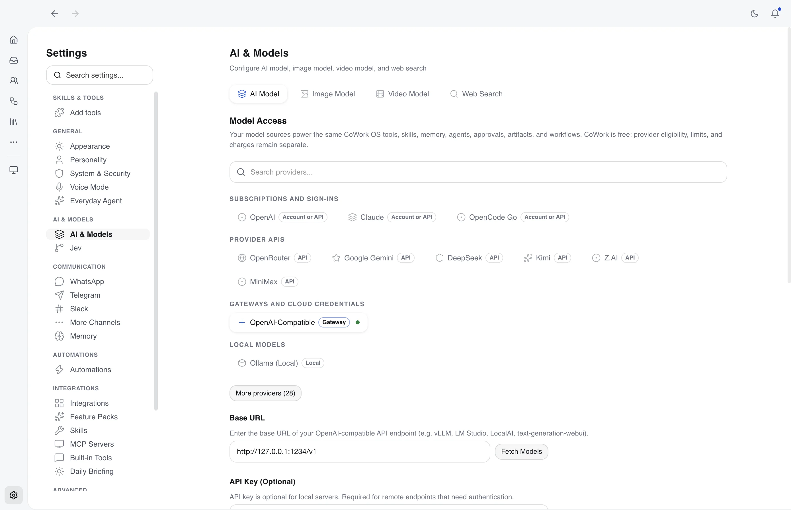

# Models & Access

CoWork OS is a **free, open-source AI super app powered by a multi-provider agent harness**.
The app itself does not require a CoWork subscription. To run AI tasks, connect a supported
provider account, API key, compatible gateway, cloud credential, or local model.

> **Cost and eligibility:** CoWork does not proxy or resell model access. Provider eligibility,
> plan limits, usage charges, and third-party-harness rules remain with each provider and can
> change independently of CoWork.

The surrounding CoWork workspace stays consistent when routes change: tools, skills, memory,
agents, approvals, artifacts, automations, and task context belong to the CoWork harness.
Individual models still differ in tool use, vision, reasoning, streaming, caching, and context
limits.

## Rent the model, own everything else

| You rent                                                           | You own                                                                                     |
| ------------------------------------------------------------------ | ------------------------------------------------------------------------------------------- |
| The model that answers, from a supported provider or a local model | Your workspace folders and the files CoWork generates                                       |
| The provider account, API key, gateway, or cloud credential        | The memory folder: plain markdown notes in a local git repo                                 |
| Usage, billed directly by the provider                             | Skills, agents, automations, approval rules, and conversation history, kept on your machine |

Switch the model for one conversation from the model picker; the conversation keeps its history.
[What You Own](what-you-own.md) lists where each item is stored, how to back it up or move it, and
what a task sends to your provider.

Provider or subscription access answers **which model can respond**; the task
[access profile](access-profiles.md) answers **what that task may do**. A
provider account, API key, or local model does not grant command tools,
filesystem, network, domain, connector, or device access, and changing models
does not widen the active profile.

<p align="center">
  
  <br><em>Provider settings centralize built-in models, compatible gateways, authentication, and fallback routing.</em>
</p>

## Access Types

### Supported accounts and subscriptions

Account-based routes use provider-controlled authentication. They are not universal
subscription compatibility, and an eligible plan does not guarantee that every request is
included in a subscription allowance.

### APIs, gateways, and cloud credentials

Direct API routes are billed by the configured provider. Compatible endpoints and gateways
let organizations use existing routing infrastructure while keeping the CoWork work surface.

### Local models

Ollama, MLX-LM, oMLX, Hugging Face local routes, and the optional Atomic Chat adapter can keep inference on the machine. Cloud routes send
prompts and authentication data to the configured provider as required to complete requests. See
the dedicated [MLX-LM Local Inference guide](mlx-lm.md) for Apple Silicon setup, runtime details,
and troubleshooting. See [Atomic Chat inference](atomic-chat.md) for the inference-only local API
integration.

For LM Studio, see [LM Studio (Local)](#lm-studio-local) below.

## Keys from a password manager

Any API key field can hold a reference to an item in your password manager instead of the key.
The same works for an MCP server's environment variables and headers. CoWork reads the value when
a request needs it, keeps it in memory for up to 10 minutes, and never writes it to disk or to
settings; settings keep only the reference.

| Reference | Vault | Read with |
| --- | --- | --- |
| `op://<vault>/<item>/<field>` or `op://<vault>/<item>/<section>/<field>` | 1Password | `op read` |
| `bws://<secret-id>` | Bitwarden Secrets Manager | `bws secret get` |
| `bw://<item>/<field>` | Bitwarden password manager | `bw get` |

For `bw://`, `<item>` is the item's id or its exact name, and `<field>` is `password`,
`username`, `notes`, `totp` or the name of a custom field. `bw://<item>` alone reads the password.

Set the vaults up in **Settings > System & Security > Password Managers**:

- **1Password**: install the 1Password CLI. With the 1Password app's CLI integration on, the app
  asks you to approve access. For runs nobody watches (`cowork run`, scheduled tasks), save a
  service account token, or export `OP_SERVICE_ACCOUNT_TOKEN` for `cowork run`.
- **Bitwarden Secrets Manager**: install `bws` and save a machine account access token (and the
  server URL for a self-hosted or EU vault). `cowork run` also reads `BWS_ACCESS_TOKEN`.
- **Bitwarden**: install `bw`, run `bw login` once, then unlock with your master password in
  Settings. The session stays in memory until you lock it, quit, or leave it idle for 30 minutes.
  For `cowork run`, set `BW_SESSION` from `bw unlock --raw`.

**Test a reference** in the same place checks that CoWork can read a reference without showing
its value. A reference that can't be read stops the request with a message that names the
reference and what to fix, for example an unlocked vault or a missing item. CoWork does not fall
back to an older value. `cowork providers list` shows which keys come from a vault.

References work for LLM provider keys (including the keys image, video and vision features reuse)
and MCP connector environment variables and headers. Other credentials, such as search provider
keys and messaging channel tokens, still need the key itself.

## Built-in Model Routes

| Provider               | Configuration                                                  | Billing                                                                                                            |
| ---------------------- | -------------------------------------------------------------- | ------------------------------------------------------------------------------------------------------------------ |
| Claude                 | Claude API key or supported account token in Settings          | API or provider-controlled extra usage; verify current Anthropic terms                                             |
| Azure Anthropic        | API key + endpoint + deployment in Settings                    | Pay-per-token via Azure                                                                                            |
| Google Gemini          | API key in Settings                                            | Free usage available through Google AI Studio subject to Google's current limits; pay-per-token beyond free limits |
| OpenRouter             | Sign in during onboarding (no key), or API key in Settings     | Free model options available; pay-per-token for premium models                                                     |
| DeepSeek               | API key in Settings                                            | Provider billing                                                                                                   |
| OpenAI (API Key)       | API key in Settings                                            | Pay-per-token                                                                                                      |
| OpenAI (ChatGPT)       | Sign in with ChatGPT (official flow; legacy Codex sign-in kept as an unofficial fallback) | Provider-controlled plan eligibility and usage limits apply                                                        |
| AWS Bedrock            | AWS credentials in Settings (auto-resolves inference profiles) | Pay-per-token via AWS                                                                                              |
| Azure OpenAI           | API key + endpoint in Settings                                 | Pay-per-token via Azure                                                                                            |
| Mixture of Agents      | Presets composed from already-configured providers             | No separate billing; each selected provider bills normally                                                         |
| Ollama (Local)         | Install Ollama and pull models                                 | No hosted-model usage charge; compute runs locally                                                                 |
| HuggingFace Local AI   | Install `hf-agents` and run `llama.cpp` locally                | No hosted-model usage charge; compute runs locally                                                                 |
| oMLX                  | Start oMLX, refresh models, and select a chat model           | No hosted-model usage charge; inference runs on your oMLX server                                                    |
| MLX (Apple Silicon)    | Install `mlx-lm` and use a quantized MLX model                 | No hosted-model usage charge; Apple Silicon compute runs locally                                                   |
| Atomic Chat (local)    | Start Atomic Chat, then refresh the running `/v1/models` endpoint in Settings | No hosted-model usage charge from CoWork; Atomic Chat's selected backend and any configured upstream service still apply |
| Groq                   | API key in Settings                                            | Free usage available subject to Groq's current limits; pay-per-token beyond free limits                            |
| xAI (Grok API)         | API key in Settings                                            | Pay-per-token                                                                                                      |
| xAI Grok OAuth         | Browser sign-in in Settings                                    | Experimental; provider authorization and plan eligibility apply                                                    |
| Kimi (Moonshot)        | API key in Settings                                            | Pay-per-token                                                                                                      |
| Pi (Multi-LLM)         | Unified API via pi-ai                                          | Routes to multiple providers                                                                                       |

## Compatible, Gateway, and Additional Routes

| Provider                      | Configuration                                  | Billing                                                                 |
| ----------------------------- | ---------------------------------------------- | ----------------------------------------------------------------------- |
| OpenCode Zen                  | API key + base URL in Settings                 | Provider billing                                                        |
| OpenCode Go                   | API key or supported account token in Settings | Provider-controlled plan eligibility and usage limits apply             |
| Google Vertex                 | Access token + base URL in Settings            | Provider billing                                                        |
| Z.AI                          | API key in Settings                            | Pay-as-you-go API billing; GLM Coding Plan keys are not supported       |
| GLM (BigModel China)          | API key in Settings                            | Pay-as-you-go API billing; GLM Coding Plan keys are not supported       |
| Vercel AI Gateway             | API key in Settings                            | Provider billing                                                        |
| Cerebras                      | API key in Settings                            | Provider billing                                                        |
| Mistral                       | API key in Settings                            | Provider billing                                                        |
| GitHub Copilot                | GitHub token in Settings                       | Experimental; provider authorization and subscription eligibility apply |
| Moonshot (Kimi)               | API key in Settings                            | Provider billing                                                        |
| Qwen Portal                   | API key in Settings                            | Provider billing                                                        |
| MiniMax                       | API key in Settings                            | Provider billing                                                        |
| MiniMax Portal                | API key in Settings                            | Provider billing                                                        |
| Xiaomi MiMo                   | API key in Settings                            | Provider billing                                                        |
| Obscurify.ai                  | API key in Settings                            | Provider billing                                                        |
| Venice AI                     | API key in Settings                            | Provider billing                                                        |
| Synthetic                     | API key in Settings                            | Provider billing                                                        |
| Kimi Code                     | API key in Settings                            | Provider billing                                                        |
| Kimi Coding                   | API key in Settings                            | Provider billing                                                        |
| OpenAI-Compatible (Custom)    | API key + base URL in Settings                 | Provider billing                                                        |
| Anthropic-Compatible (Custom) | API key + base URL in Settings                 | Provider billing                                                        |

**Your usage is billed directly by your provider.** CoWork OS does not proxy or resell model
access or promise that a commercial provider includes third-party-harness usage in a plan.

---

## Ordered LLM Fallback Chains

CoWork OS can route a task through an explicit provider/model fallback chain instead of relying on a single primary provider.

Configure this in **Settings > AI & Models**:

- choose your primary provider/model
- add fallback providers in order
- optionally choose capability-based routing for workflow phases or specialized tasks

Fallback chains are used when a provider is unavailable, rate-limited, rejected by policy, or lacks the required capability for the task. Runtime surfaces in the app and Mission Control show the active provider, routing reason, and whether a fallback occurred.

For LLM chains, retryable provider failures such as `429` rate limits and transient upstream errors move execution to the next configured provider/model in the ordered list. Once a fallback route is active, CoWork OS preserves that working route briefly so retries do not immediately bounce back to the primary provider.

You can control when the primary route is tried again in **Settings > AI & Models > Provider Failover > Retry primary after (seconds)**:

- leave it blank to use the default 60-second cooldown
- set it to `0` to retry the primary on the next route refresh
- set a value up to `3600` seconds to keep the active fallback route longer before probing the primary again

---

## Mixture of Agents

Mixture of Agents is a virtual LLM provider for preset-based model collaboration. A preset runs one or more reference advisor models first, then passes their bounded advisory notes to a final aggregator model that answers the task.

Configure it in **Settings > AI & Models > AI Model > Mixture of Agents**:

- create an enabled preset
- choose the aggregator provider/model
- add reference advisor provider/model slots
- tune advisor token limits, advisory context size, and advisor concurrency
- save settings, then select **Mixture of Agents** as the provider and the preset as the model

Advisor calls are intentionally tool-free. The aggregator receives the original task messages, tools, and tool choice, so workspace edits, shell commands, browser actions, and MCP calls still happen through the final route.

MoA has two failover layers:

- slot-level failover from each selected provider's own fallback chain
- optional MoA-provider failover for falling back from the whole preset to another provider/model

MoA does not automatically inherit global fallback providers. Configure MoA provider failover only when you want the entire preset to fall back after the MoA route fails.

See [Mixture of Agents](mixture-of-agents.md) for preset design, runtime behavior, UI testing, and corporate TLS troubleshooting.

---

## Prompt Caching

CoWork OS enables prompt caching by default in `auto` mode for supported model routes. The cacheable prefix is built from session-scoped prompt sections, while volatile turn context stays outside the stable prefix so follow-ups and routed turns can keep reusing the same provider-side foundation.

### Strategy by provider family

- **Claude API / subscription tokens / Azure Anthropic / Anthropic-compatible**: CoWork marks the stable system prefix and prefers Anthropic automatic caching for the conversation. On supported Claude models, changing turn context is appended after the latest user/tool results as a scoped system message. Earlier context snapshots are persisted with assistant responses and replayed unchanged, including across session restoration; signed thinking is preserved when its original prefix still matches. If an endpoint rejects scoped context, CoWork remembers the rejection for that model and retries with the complete current global system prompt. If a route rejects automatic cache control, CoWork tries explicit breakpoints, then removes rejected cache controls for that model while retaining all instructions. Explicit caching uses at most four breakpoints, including the stable system marker; scoped system messages never receive cache markers.
- **OpenRouter Claude**: CoWork uses explicit cache breakpoints over the stable system prefix plus the last 3 non-system messages, with a maximum of 4 total breakpoints.
- **OpenAI / Azure OpenAI**: CoWork derives a deterministic stable-prefix cache key and sends it through OpenAI-style prompt-cache fields. Changing turn context follows conversation history as a system message, preserving earlier message prefixes on both Chat Completions and Responses routes.
- **OpenAI ChatGPT subscriptions**: CoWork uses the Codex HTTP/SSE transport and forwards a stable session key as `prompt_cache_key` and session routing headers. Stable instructions and conversation history stay unchanged; changing turn context is sent as a developer message after the history, so it does not invalidate earlier messages. This route uses backend-managed implicit caching and omits the API-only `prompt_cache_options` / `prompt_cache_retention` fields. The configured short/long retention is passed to the SDK, but does not guarantee that lifetime on the ChatGPT backend.
- **OpenRouter automatic routes**: CoWork participates in stable-prefix partitioning and cache-epoch tracking, sends model-scoped OpenRouter session affinity, and does not add Anthropic-specific markers.
- **OpenRouter Qwen/DeepSeek explicit-cache routes**: CoWork uses Anthropic-compatible `cache_control` breakpoints where OpenRouter documents that syntax; other OpenRouter models use router-managed implicit caching and fall back cleanly if a route rejects the optional metadata.
- **Bedrock Claude/Nova and Pi-backed Claude/OpenAI routes**: CoWork forwards provider-native cache retention controls and preserves cache-read/cache-write usage in telemetry. Pi keeps every system block when caching is off or rejected, preserves SDK-owned authentication instructions, and surfaces failed requests for normal error handling. Bedrock only retries cache compatibility errors when cache controls were sent. Nova uses system/message checkpoints with its supported short TTL; tool checkpoints and long TTLs remain Claude-specific where supported.
- **Gemini and DeepSeek**: Their upstream implicit caches operate automatically. CoWork records Gemini's `cachedContentTokenCount` and DeepSeek's `prompt_cache_hit_tokens` as cached input tokens, including through the shared compatible-provider adapters where applicable.

Claude's scoped-context path uses the `mid-conversation-system-clear-at-2026-08-21` beta and is limited to the [documented supporting models](https://platform.claude.com/docs/en/build-with-claude/mid-conversation-system-messages): Fable 5/5.1, Mythos 5/5.1, Opus 4.8/5/5.5, Sonnet 5.5, and Haiku 5.5. Sonnet 5 and older unsupported models keep the complete global system prompt. Cleared context remains byte-for-byte in the request history and costs no input tokens. On the request that clears it, Claude may reprocess the latest assistant reply; the reusable prefix ends at the user turn preceding that context. Stable system instructions and tools must still match, and compaction or history edits intentionally invalidate affected replay metadata.

Routes that still use one global system field, including Bedrock Converse, Pi-backed Claude, OpenRouter Claude, Gemini, and unsupported compatible gateways, reuse the stable system prefix. Reusing later conversation history also requires the preceding system text to remain unchanged. Current turn instructions retain their system priority on these routes.

### What stays cacheable

Cacheable prefix material comes from stable session-scoped sections such as:

- identity and safety core
- workspace / worktree context
- mode and task-domain contracts
- role, personality, and guidelines
- tool policy and rendered tool schema

Dynamic turn-scoped material such as current time, layered memory sections (`<cowork_hot_memory>`, `<cowork_relevant_memory>`, the memory context section), and turn guidance is intentionally kept outside the stable prefix. Conversation, archive and topic-pack recall are tool-driven, so they only enter the active turn after an explicit `memory_recall` or `context_recall` call.

### Defaults and overrides

- Default mode: `auto`
- Default TTL: `5m`
- Optional long TTL: `1h`
- Advanced disable: set `promptCaching.mode` to `off` in saved LLM settings or launch with `COWORK_PROMPT_CACHE_MODE=off`
- Advanced TTL override: `COWORK_PROMPT_CACHE_TTL=5m|1h`

### Telemetry

When an upstream provider reports prompt-cache usage, CoWork records:

- `cachedTokens`: tokens served from the provider cache
- `cacheWriteTokens`: tokens spent creating or extending the cache entry, when available
- `cacheWriteTtl`: the provider-reported `5m` or `1h` write window when available; otherwise CoWork uses the configured request TTL for local cost estimation

These values flow into Usage Insights and cost accounting.

Cache hits depend on the upstream backend and an eligible matching prefix. Sending a cache key alone does not prove reuse; check provider-reported `cachedTokens` on repeated requests. Turning CoWork caching off removes its cache metadata and prefix splitting; provider-managed implicit caching may still occur.

---

## Model Prices and Context Limits

Cost estimates, cost budgets and context-window sizes come from a price list generated from the public [models.dev](https://models.dev) catalogue (`src/shared/model-metadata.json`).

- **Bundled with each release.** A weekly CI job (`.github/workflows/model-metadata-sync.yml`) runs `npm run models:sync` and opens a pull request when prices or models change.
- **Live provider data.** When CoWork lists OpenRouter models, OpenRouter's reported prices and context lengths take precedence.
- **Optional daily refresh (off by default).** Enable **Refresh model prices and context limits daily** in **Settings > AI & Models > Model Access** to download the models.dev catalogue once a day between releases. It is one anonymous `GET https://models.dev/api.json` with no prompts, usage data or identifiers; set `COWORK_DISABLE_MODEL_METADATA_REFRESH=1` to block it entirely.
- **Unknown models are not free.** A model without a price shows cost as **Unknown** (or `$x+` when some usage was priced). Usage Insights counts these calls separately, and cost budgets cannot account for them.
- **Local models** (Ollama, MLX, oMLX, Atomic Chat) and OpenRouter `:free` routes are counted as $0.
- **Per-task cost:** the task panel's **Cost** section shows spend so far, the cap that applies (the task's own budget or **Settings > System & Security > Safety Limits**), and token counts; on a finished task it is the receipt. Before any usage it shows the typical cost of a task on the selected model, from your own last 30 tasks (computed locally).
- **Newer Claude tokenizer:** Opus 4.7 and later (including Opus 5.x and Fable) produce up to ~1.35x as many tokens for the same text. Costs use the provider's reported token counts, so they are unaffected; CoWork's own context estimate is scaled so compaction runs early enough.

Retired models and deliberate exceptions live in `src/electron/agent/llm/pricing-overrides.ts`. `pricing-coverage.test.ts` fails when a model CoWork offers has no price.

## Adaptive Output Budgeting

When `COWORK_LLM_OUTPUT_POLICY=adaptive` is enabled, CoWork OS applies a shared output-budget policy for agentic execution turns across the main provider families instead of relying on provider defaults.

### What it covers

The current rollout resolves explicit output limits for:

- Anthropic-family routes
- Bedrock Claude routes
- OpenAI routes
- Azure OpenAI routes
- Gemini routes
- OpenRouter routes
- a conservative generic fallback for the remaining providers

This policy currently targets execution and follow-up turns first. Explicit chat keeps its separate behavior for now, and `legacy` mode preserves the older executor path.

### Default request budgets

Internal defaults are:

- first execution turn: `8000`
- tool-follow-up turn: `16000`
- one-shot escalated retry after truncation: `48000`
- one-shot escalated retry for Anthropic-family routes: `64000`
- generic fallback escalation: `16000`

Budget selection is resolved in this order:

1. task-level `agentConfig.maxTokens`, when present
2. `COWORK_LLM_MAX_OUTPUT_TOKENS`
3. adaptive family defaults
4. final clamping by known hard caps and context headroom

### Transport fields by provider shape

CoWork maps the chosen budget into the provider-appropriate request field:

- `max_tokens` for Anthropic-style, OpenRouter-style, and most compatible chat-completions routes
- `max_completion_tokens` for newer OpenAI-style reasoning/chat-completions routes
- `max_output_tokens` for Gemini and OpenAI-style responses routes

This mapping is resolved centrally so execution behavior stays consistent even when providers differ in field names.

### Truncation recovery behavior

If an execution turn hits the output limit:

1. CoWork retries the same request once with a larger budget
2. if the retried response still truncates but contains visible partial output, CoWork falls back to a continuation prompt
3. if the retried response contains only reasoning or no usable answer text, CoWork stops retrying continuations and surfaces targeted guidance instead

This avoids wasting turns on repeated truncation loops that produce no visible answer.

### Internal controls

This rollout is currently controlled by environment flags rather than UI settings:

- `COWORK_LLM_OUTPUT_POLICY=legacy|adaptive`
- `COWORK_LLM_MAX_OUTPUT_TOKENS`
- `COWORK_LLM_AGENTIC_INITIAL_MAX_TOKENS`
- `COWORK_LLM_AGENTIC_ESCALATED_MAX_TOKENS`

`COWORK_LLM_OUTPUT_POLICY` defaults to `legacy` unless explicitly set. `COWORK_LLM_TOOL_RESPONSE_MAX_TOKENS` remains available for legacy compatibility but is no longer the primary behavior in adaptive mode.

---

## Azure Anthropic

Use Azure-hosted Claude models through your Azure subscription.

### Setup

1. Deploy a Claude model in your Azure AI Studio account.
2. Open **Settings > AI & Models > Model Access** and select **Azure Anthropic**.
3. Enter your Azure API key, endpoint URL (e.g. `https://<resource>.services.ai.azure.com`), and deployment name.

### Notes

- Uses the Anthropic messages API format, not the Azure OpenAI format.
- Separate from the existing **Azure OpenAI** provider — use this for Claude models, Azure OpenAI for GPT models.
- All billing goes through your Azure subscription.

---

## Ollama (Local LLMs)

Run inference locally without hosted-model usage charges. After the required models and dependencies are installed, this route can operate offline; hardware and electricity costs remain yours.

### Setup

```bash
brew install ollama
ollama pull llama3.2
ollama serve
```

### Recommended Models

| Model             | Size | Best For             |
| ----------------- | ---- | -------------------- |
| `llama3.2`        | 3B   | Quick tasks          |
| `qwen2.5:14b`     | 14B  | Balanced performance |
| `deepseek-r1:14b` | 14B  | Coding tasks         |

---

## LM Studio (Local)

Use LM Studio through the **OpenAI-Compatible** provider.

### Setup

1. Download a model in LM Studio and load it with enough context for agent prompts.
   For example, with the LM Studio CLI installed:

   ```bash
   lms load <model> -c 32768
   lms server start --port 1234
   ```

   You can also load the model and start the server from the app's **Developer** tab.
2. Open **Settings > AI & Models > More providers > OpenAI-Compatible** in CoWork.
3. Set the base URL to `http://localhost:1234/v1`. Leave the API key empty unless
   you have enabled authentication in LM Studio.
4. Click **Fetch Models**, then select your loaded model.

The server must remain running while CoWork uses the model. A 32,768-token context
is a useful starting point; choose a context size your model and hardware support.

---

## HuggingFace Local AI (`hf-agents` + `llama.cpp`)

Run compatible local models through CoWork's HuggingFace Local AI provider.

### Setup

```bash
pip install huggingface_hub
hf extensions install hf-agents
```

Then open **Settings > AI & Models > Model Access**, choose **HuggingFace Local AI**, select or enter a model, and start the local `llama.cpp` server from the provider panel.

### Notes

- Default local endpoint: `http://localhost:8080/v1`
- API key is optional for local runs
- Best fit when you want a private local provider but do not want to depend on Ollama

---

## MLX-LM (`mlx`)

Run quantized models natively on Apple Silicon through Apple's open-source MLX framework and
the MLX-LM OpenAI-compatible local server. The complete setup, API, lifecycle, privacy, and
troubleshooting contract is documented in [MLX-LM Local Inference](mlx-lm.md).

### Setup

```bash
python3 -m pip install --upgrade mlx-lm
```

Then open **Settings > AI & Models > Model Access**, choose **MLX (Apple Silicon)**, select a
model, and start the **MLX Server**. CoWork connects to `http://localhost:8080/v1`.

Recommended starting models:

- `mlx-community/Qwen3-8B-4bit` for a smaller, faster local model
- `mlx-community/Qwen3-14B-4bit` for a balanced model
- `mlx-community/Qwen3.6-35B-A3B-4bit-DWQ` for larger Apple Silicon systems

The MLX server downloads models from Hugging Face on first use and keeps inference local. It is
intended for local development, not as a production-exposed service.

---

## oMLX (`omlx`)

Connect to an already-running [oMLX server](https://github.com/jundot/omlx) using its
OpenAI-compatible API. Start oMLX on your Apple Silicon Mac and download a chat model
in oMLX before configuring CoWork.

1. Open **Settings > AI & Models > Model Access**, search for **oMLX**, and select it
   under **Local models**. You can also find it under **More providers**.
2. Keep `http://localhost:8000/v1`, or enter your server's URL. A bare server URL also
   works; CoWork adds `/v1`.
3. If authentication is enabled, copy your API key from **oMLX > Security** into
   CoWork's **API Key** field. The field is optional only for servers that allow
   unauthenticated inference; a running local server can still require a key.
4. Click **Refresh Models** and select the exact chat model ID or alias. You can also
   enter it manually; CoWork does not assume a model is installed.
5. Test the connection and save your settings.

Tool calling requires a model that supports tools; image input requires a vision-language
model. CoWork manages its own tools and approvals. Start/stop, model downloads, and memory
management remain in oMLX. If connection testing fails, check that oMLX is running, the URL
and API key match its settings, and the selected model supports chat completions. Remote
server URLs send inference data to that server.

### Refresh Models troubleshooting

A running oMLX server does not guarantee that its API accepts unauthenticated requests.
If **Refresh Models** returns no models, check the error displayed beside the model
selector. CoWork reports discovery failures without replacing the saved model selection
or cached list, and model discovery times out after five seconds.

| Error | What to do |
| --- | --- |
| API key required or rejected (`401` / `403`) | Copy the current key from **oMLX > Security** into CoWork's **API Key** field, then refresh again. |
| Server unreachable | Check the server is running and copy its **OpenAI-compatible** endpoint from **oMLX > Server** into CoWork's **Base URL** field, for example `http://127.0.0.1:8000/v1`. |
| No models reported | Download a chat model in oMLX, then refresh again. |
| Discovery timed out | Check oMLX's status and logs, then retry. |
| Incompatible model list | Check the URL points to oMLX's OpenAI-compatible API rather than its dashboard or Anthropic endpoint. |

For a direct check without sending credentials, run:

```bash
curl -i http://127.0.0.1:8000/v1/models
```

An HTTP `401` response containing `API key required` confirms the server is reachable
and requires authentication. Enter the key in CoWork before refreshing; it is not a
missing-model or server-startup problem. After updating CoWork's provider implementation,
restart CoWork so the desktop backend loads the change.

## Atomic Chat (Local)

CoWork can connect to an already-running [Atomic Chat](https://atomic.chat/)
instance through its OpenAI-compatible API. This route is an inference adapter:
CoWork keeps ownership of the task loop, tools, permissions, approvals,
evidence, and persistence. It does not start Atomic Chat, install models, or
import Atomic Agent's tool loop.

### Setup

1. Start Atomic Chat and load a model.
2. Open **Settings > AI & Models > Model Access** and choose **Atomic Chat
   (local)**.
3. Keep the default endpoint `http://127.0.0.1:1337/v1`, or enter the endpoint
   exposed by the running instance.
4. Use **Refresh Models** and select the exact model ID returned by `/v1/models`.
5. Add an API key only when the Atomic Chat proxy requires authentication.

The initial adapter uses non-streaming `/v1/chat/completions` requests with a
60-second inference deadline. Discovery has a five-second deadline and retains
the existing model selection when discovery fails. See [Atomic Chat inference](atomic-chat.md)
for typed failure states, troubleshooting, and qualification limits. The
optional [local-model execution profile](local-model-execution.md) adds bounded
budgets and local admission control without changing the permission model.

---

## Google Gemini

1. Get API key from [Google AI Studio](https://aistudio.google.com/apikey)
2. Configure in **Settings** > **Google Gemini**

Models: `gemini-2.5-flash` (default, fast), `gemini-2.5-pro` (most capable)

---

## OpenRouter

Access multiple AI providers through one API.

### Sign in with OpenRouter (no key)

Onboarding's first option is **Continue with OpenRouter (free models, no key)**. After setup, use
**Sign in with OpenRouter** under **Settings > AI & Models > Model Access > OpenRouter**. Both use
OpenRouter's [OAuth PKCE flow](https://openrouter.ai/docs/use-cases/oauth-pkce):

1. CoWork opens `https://openrouter.ai/auth` in your browser with a one-time S256 code
   challenge and a callback to a short-lived server on your computer's loopback address
   (`127.0.0.1`, random port, path `/callback`).
2. Sign in to OpenRouter or create an account, then approve the request. OpenRouter redirects
   back with an authorization code.
3. CoWork exchanges the code and its verifier at `POST https://openrouter.ai/api/v1/auth/keys`
   for an API key scoped to your OpenRouter account, labelled "CoWork OS". The main process
   stores the key in the encrypted settings store (Electron `safeStorage`) like any other
   credential; the sign-in never passes it through the app window. Settings then shows it in the
   masked OpenRouter API key field, as it does a pasted key.

The sign-in itself proves the key, so onboarding skips the connection test. Onboarding offers a
detected local Ollama model beside the ChatGPT and Grok sign-ins on the same step. A first sign-in
selects `openrouter/free`, OpenRouter's free-models router: it picks a free model that supports
the request's needs (tools, images, structured output), so a new account with no credits can run
a task. Free models are slower and less capable than paid ones and have their own rate limits.
Pick another model at any time in the model picker or in **Settings > AI & Models**. Signing in
again with an existing key keeps the model you chose.

You can manage or revoke the key at [openrouter.ai/keys](https://openrouter.ai/keys). The
sign-in waits five minutes for the browser; start it again if it times out.

### OpenRouter API key

1. Get API key from [OpenRouter](https://openrouter.ai/keys)
2. Configure in **Settings > AI & Models > Model Access > OpenRouter**

Available: Claude, GPT-4, Gemini, Llama, Mistral, and more — see [openrouter.ai/models](https://openrouter.ai/models)

### Jev decision support

CoWork also supports [Jev Decision Support](jev.md) as a separate structured
decision route. Jev can choose an agent team and leader for Collaborative mode
and `/multitask`, and Active harness mode can make bounded model-routing,
task-strategy, lane, browser, loop, context, skill/tool, output, and tool-review
decisions without replacing the OpenRouter chat model that executes the work.
Jev tokens and provider-reported cost are recorded separately from normal LLM
usage; Jev does not use the LLM pricing table.
To use the OpenRouter route for Jev, save the OpenRouter key here,
then select **OpenRouter** in **Settings > AI & Models > Jev** and leave key
reuse enabled. The same key is used once for both routes.

### Pareto Code Router

OpenRouter's Pareto Code Router is available as a normal OpenRouter model selection, not as a separate provider:

| Model ID                       | Display name               | Use when                                                                                           |
| ------------------------------ | -------------------------- | -------------------------------------------------------------------------------------------------- |
| `openrouter/pareto-code`       | Pareto Code Router         | You want OpenRouter to choose a strong coding model from its coding frontier                       |
| `openrouter/pareto-code:nitro` | Pareto Code Router (Nitro) | You want the same coding-score routing, but prefer the fastest measured model in the selected tier |

When one of those models is selected, **Settings > AI & Models > OpenRouter** shows a **Pareto Router** field for the optional minimum coding score.

- `min_coding_score` is a decimal number from `0` to `1`; do not enter percentages such as `80`.
- Leave the field blank to let OpenRouter use its default strongest/high coding tier.
- Current OpenRouter tiers are `>= 0.66` for high, `0.33` to `< 0.66` for medium, and `< 0.33` for lower-cost low-tier routing.
- The score is sent through OpenRouter's `pareto-router` plugin only for `openrouter/pareto-code` and `openrouter/pareto-code:nitro`.
- In headless or VPS installs, pass the same value through Control Plane as `settings.paretoMinCodingScore`, for example `{"providerType":"openrouter","model":"openrouter/pareto-code","settings":{"paretoMinCodingScore":0.8}}`.
- The response `model` field can report the concrete underlying model that handled the request, so usage and cost records may show a Claude, GPT, Gemini, DeepSeek, or other routed model rather than the router id.
- The fallback local catalog lists both Pareto models with OpenRouter's documented `200,000` token context. When the live OpenRouter model catalog returns metadata, CoWork keeps the live catalog value instead of overriding it.

The Pareto Router itself adds no extra fee. Billing follows whichever underlying OpenRouter model handles the request, so cost can vary by tier and availability.

Reference: [OpenRouter Pareto Router docs](https://openrouter.ai/docs/guides/routing/routers/pareto-router) and [Pareto Code Router model page](https://openrouter.ai/openrouter/pareto-code).

CoWork OS also sends OpenRouter app attribution headers by default so usage is associated with the app in OpenRouter analytics and rankings. The current defaults are:

- `HTTP-Referer: https://github.com/CoWork-OS/CoWork-OS`
- `X-OpenRouter-Title: CoWork OS`
- `X-Title: CoWork OS`
- `X-OpenRouter-Categories: personal-agent,programming-app`

The category pairing is intentional: CoWork OS is positioned primarily as a personal AI agent, with programming workflows as a secondary fit.

For prompt caching, OpenRouter Claude routes use explicit Anthropic-style cache breakpoints, while GPT-style OpenRouter routes participate in the shared stable-prefix prompt-cache pipeline.

---

## OpenAI / ChatGPT

- **Option 1: API Key** — Standard pay-per-token access to GPT models
- **Option 2: Sign in with ChatGPT** — OpenAI's official sign-in flow for third-party apps. Requests use the usage included in your ChatGPT plan, so no API key is needed. You can set a weekly CoWork OS usage cap or revoke access in ChatGPT settings. Image generation is not available with this sign-in.
- **Legacy Codex sign-in (unofficial)** — The older ChatGPT/Codex OAuth route stays available as a fallback marked unofficial. OpenAI does not support it in third-party apps and it may stop working at any time; disconnect it and use Sign in with ChatGPT instead.

### Models with Sign in with ChatGPT

After sign-in, CoWork reads your plan and suggests a model: GPT-6 Luna (`gpt-6-luna`) on the Free and Go plans, and GPT-6 Astra (`gpt-6-astra`) on paid plans. The built-in catalog also includes GPT-6 Sol (`gpt-6-sol`), GPT-6.1 Sol (`gpt-6.1-sol`) and the earlier GPT-5.x models. The signed-in account and OpenAI backend remain the source of truth for which models and controls are actually available.

Reasoning effort is a request control, not a separate model ID. Choose the
model first, then set its effort from either:

- the main model picker's **Intelligence** section for the active task route
- **Settings > AI & Models > OpenAI Request Controls** for the saved OpenAI
  provider configuration

The UI only lists efforts the selected model supports (from None through
Extra High, Max and, on some models, Ultra). Max requests the deepest standard
reasoning mode; Ultra requests maximum reasoning with the ChatGPT/Codex
automatic task-delegation mode. Response verbosity (Low, Medium, High) changes
final-answer detail independently of reasoning effort.

Model and effort availability remains account-, plan-, and entitlement-dependent.
If a model is listed locally but the ChatGPT backend rejects it, refresh the
model list, confirm the signed-in account has access, or select an available
model/effort combination.

---

## xAI / Grok

CoWork OS supports Grok through either direct xAI API billing or a browser OAuth account connection. Account eligibility, model access, limits, and charges remain controlled by xAI.

### Option 1: Grok Account Connection

Use this when the OAuth route is available to your xAI account and you do not want to manage an `XAI_API_KEY`.

1. Open **Settings > AI & Models > Model Access**.
2. Select **Grok OAuth** or open the **xAI** provider panel and choose the account connection shown there.
3. Click **Sign in with Grok**.
4. Complete the xAI browser sign-in and consent flow.
5. Refresh the model list and select a model available to the connected account.
6. Click **Test Connection**, then save settings.

CoWork stores the OAuth tokens in encrypted LLM settings for the current profile and refreshes the access token before model calls. Logging out from the same panel clears the stored xAI OAuth tokens without removing an xAI API key.

### Option 2: xAI API Key

Use this when you want pay-per-token API billing through the xAI developer console.

1. Create or copy an API key from [xAI Console](https://console.x.ai/).
2. Open **Settings > AI & Models > Model Access** and select **xAI API Key**.
3. Paste the key, click **Refresh Models**, choose a model, then save.

### Models

The built-in Grok catalog provides fallback model metadata for the OAuth route. Refreshing models against the connected account is the source of truth:

| Model ID                       | Notes                                      |
| ------------------------------ | ------------------------------------------ |
| `grok-4.3`                     | Default OAuth model for chat and reasoning |
| `grok-4.20-0309-reasoning`     | Reasoning variant                          |
| `grok-4.20-0309-non-reasoning` | Non-reasoning variant                      |
| `grok-4.20-multi-agent-0309`   | Multi-agent variant                        |

### Transport and endpoint

The OAuth route uses xAI's Responses-style endpoint at `https://api.x.ai/v1`. The direct API-key route continues to use the OpenAI-compatible xAI API path. The **Base URL** field can override the endpoint for either mode when xAI changes deployment requirements or when testing a compatible gateway.

### Troubleshooting

- If the browser sign-in times out, start **Sign in with Grok** again. The loopback authorization window is intentionally finite.
- If the callback port is busy, CoWork falls back to an ephemeral local port automatically.
- If token refresh fails because the xAI session was revoked, disconnect the Grok account in Settings and sign in again.
- If a model call fails with an account, plan, or entitlement error, refresh the model list and confirm that xAI permits the requested route for the signed-in account.

References: [xAI Grok + Hermes announcement](https://x.ai/news/grok-hermes) and [Hermes xAI Grok OAuth docs](https://hermes-agent.nousresearch.com/docs/guides/xai-grok-oauth).

---

## Web Search Providers

Multi-provider web search for research tasks with automatic retry and fallback. DuckDuckGo is built-in and requires no setup — it serves as a free fallback so web search always works, even without API keys.

| Provider                 | Types             | API Key                 | Best For                                     |
| ------------------------ | ----------------- | ----------------------- | -------------------------------------------- |
| **DuckDuckGo**           | Web               | Not required (built-in) | Zero-config free fallback                    |
| **Tavily**               | Web, News         | Required                | AI-optimized results (recommended)           |
| **Exa**                  | Web, News         | Required                | Semantic search and research-heavy retrieval |
| **Brave Search**         | Web, News, Images | Required                | Privacy-focused                              |
| **SerpAPI**              | Web, News, Images | Required                | Google results                               |
| **Google Custom Search** | Web, Images       | Required                | Direct Google integration                    |

DuckDuckGo is always available as the last-resort fallback. When paid providers are configured, they are tried first in the configured order, with DuckDuckGo only used if all others fail. Search settings also support explicit primary/fallback ordering and provider cooldown behavior after repeated failures.

Configure paid providers in **Settings** > **Web Search**.

## Setup in Settings

Where each route is configured in the app. Route details are in the sections above.

### Model Providers

Open **Settings > AI & Models > Model Access**:

| Provider            | Setup                                                                                                                                                                                                                          |
| ------------------- | ------------------------------------------------------------------------------------------------------------------------------------------------------------------------------------------------------------------------------ |
| Claude              | Use **Claude API** with a key from [console.anthropic.com](https://console.anthropic.com), or, where supported and permitted for your account, use the **Claude Subscription** UI route with a token from `claude setup-token` |
| Google Gemini       | Enter API key from [aistudio.google.com](https://aistudio.google.com/apikey); Google AI Studio free usage may be available subject to current limits                                                                           |
| OpenRouter          | Enter API key from [openrouter.ai](https://openrouter.ai/keys); free model options are available, and `openrouter/pareto-code` / `openrouter/pareto-code:nitro` support coding-score-based routing                             |
| OpenAI (API Key)    | Enter API key from [platform.openai.com](https://platform.openai.com/api-keys)                                                                                                                                                 |
| OpenAI (ChatGPT)    | Click **Sign in with ChatGPT** to connect an eligible account; available models, limits, and charges depend on OpenAI and the account plan                                                                                     |
| AWS Bedrock         | Enter AWS Access Key, Secret Key, and Region                                                                                                                                                                                   |
| Ollama              | Install Ollama, pull a model, select it                                                                                                                                                                                        |
| MLX (Apple Silicon) | Install `mlx-lm`, select a compatible quantized model, start the MLX server                                                                                                                                                    |
| Groq                | Enter API key in Settings; free usage may be available subject to current limits                                                                                                                                               |
| xAI (Grok API)      | Enter API key in Settings                                                                                                                                                                                                      |
| xAI Grok OAuth      | Sign in with an eligible xAI account, refresh the available models, and select one supported for that account                                                                                                                  |
| Kimi (Moonshot)     | Enter API key in Settings                                                                                                                                                                                                      |

Prompt caching is enabled by default on supported Anthropic and GPT-style routes. CoWork automatically keeps stable session prompt sections cacheable and dynamic turn context uncached, so follow-ups can reuse the provider-side prefix without caching the clock, recall, or one-off guidance.

### Compatible / Gateway Providers

Configure these in **Settings** > **AI & Models** > **Model Access** by entering API keys or tokens, model IDs, and base URLs when required.

| Provider                      | Setup                               |
| ----------------------------- | ----------------------------------- |
| OpenCode Zen                  | API key + base URL in Settings      |
| Google Vertex                 | Access token + base URL in Settings |
| Z.AI                          | API key in Settings                 |
| GLM (BigModel China)          | API key in Settings                 |
| Vercel AI Gateway             | API key in Settings                 |
| Cerebras                      | API key in Settings                 |
| Mistral                       | API key in Settings                 |
| GitHub Copilot                | GitHub token in Settings            |
| Moonshot (Kimi)               | API key in Settings                 |
| Qwen Portal                   | API key in Settings                 |
| MiniMax                       | API key in Settings                 |
| MiniMax Portal                | API key in Settings                 |
| Xiaomi MiMo                   | API key in Settings                 |
| Venice AI                     | API key in Settings                 |
| Synthetic                     | API key in Settings                 |
| Kimi Code                     | API key in Settings                 |
| OpenAI-Compatible (Custom)    | API key + base URL in Settings      |
| Anthropic-Compatible (Custom) | API key + base URL in Settings      |

Advanced override: prompt caching can be disabled manually with `promptCaching.mode: "off"` in the saved LLM settings payload or by launching the app with `COWORK_PROMPT_CACHE_MODE=off`.

### Search Providers (Optional — DuckDuckGo works out of the box)

Web search works immediately via the built-in DuckDuckGo provider (free, no API key). For richer results (news, images, AI-optimized ranking), configure a paid provider in **Settings** > **AI & Models** > **Web Search**:

| Provider   | Setup                                                                   |
| ---------- | ----------------------------------------------------------------------- |
| DuckDuckGo | Built-in — no setup needed (automatic fallback)                         |
| Tavily     | Enter API key from [tavily.com](https://tavily.com)                     |
| Exa        | Enter API key from [exa.ai](https://exa.ai/)                            |
| Brave      | Enter API key from [brave.com/search/api](https://brave.com/search/api) |
| SerpAPI    | Enter API key from [serpapi.com](https://serpapi.com)                   |
| Google     | Enter API key and Search Engine ID from Google Cloud Console            |
